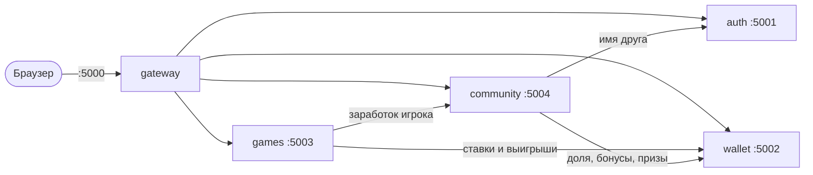

# RewardLab — микросервисы

Тот же RewardLab, что и в папке `rewardlab/`, но разделённый на пять независимых сервисов.
У каждого сервиса своя база SQLite и свой Dockerfile. Сервисы общаются по HTTP (JSON).



| Сервис | Порт | Данные | Отвечает за |
|---|---|---|---|
| **gateway** | 5000 | — (без базы) | HTML-страницы, сессии, CSRF, капча, лимиты попыток, админ-панель |
| **auth** | 5001 | `users`, `admin_log` | регистрация, вход, баны, вход админа по TOTP, журнал админа |
| **wallet** | 5002 | `balances`, `events` | балансы и журнал операций; атомарное списание, защита от двойных начислений |
| **games** | 5003 | `claims`, `quiz_done`, `bj_games` | ежечасное счастливое число, викторина, блэкджек |
| **community** | 5004 | `referrals`, `notifications`, `contest_*` | рефералы и уровни, уведомления, недельный конкурс, рейтинг пригласивших |

## Запуск

### Без Docker (Windows)

Нужен venv проекта (`..\.venv`) с зависимостями:

```
..\.venv\Scripts\python.exe -m pip install -r requirements.txt
.\run_all.ps1            # http://127.0.0.1:5000
.\run_all.ps1 -Stop      # остановить
```

При первом запуске скрипт создаёт `.env` со случайными ключами.
Логи сервисов пишутся в `logs/`, базы данных хранятся в `data/`.

### Docker

```
copy .env.example .env   # и заполните APP_SECRET и INTERNAL_TOKEN
docker compose up --build
```

Наружу (на 127.0.0.1:5000) открыт только gateway. Остальные сервисы доступны лишь во внутренней сети Docker.

### Права администратора

Выдаются только из консоли сервера:

```
python -m auth.cli make-admin <username>                         # без Docker, из папки microservices
docker compose exec auth python -m auth.cli make-admin <username>
```

## Как сервисы защищены и согласованы

- **Служебный токен.** Внутренние сервисы принимают только запросы с заголовком `X-Internal-Token`,
  равным `INTERNAL_TOKEN`. Без него ответ — 401. Токен знают только сервисы.
- **Идемпотентность.** Начисления в wallet передают `op_id` (например, `bj:42:payout`).
  Повтор того же запроса после таймаута не начислит баллы дважды.
- **Сбои.** Если wallet не ответил во время броска, бросок отменяется и его можно повторить.
  Выигрыш в блэкджеке, не дошедший до wallet, доплачивается при следующем открытии стола.
  Если не дошли бонусы за активацию друга, активация повторится со следующей наградой друга.
  Если какой-то сервис упал, gateway показывает страницу «Temporarily unavailable» (503).
- **Удаление аккаунта** проходит по всем сервисам, а auth удаляется последним.
  Поэтому прерванное удаление можно безопасно повторить.

## API (основное)

| Сервис | Метод и путь | Что делает |
|---|---|---|
| auth | `POST /register`, `POST /login` | создать аккаунт / проверить пароль |
| auth | `GET /users/<id>`, `GET /users?ids=1,2` | профиль / имена по списку id |
| auth | `POST /admin/verify`, `GET /admin/overview` | вход админа (пароль + TOTP) / данные для панели |
| wallet | `POST /credit`, `POST /debit` | начислить / списать (409, если баллов не хватает) |
| wallet | `GET /balance/<id>`, `GET /events/<id>`, `GET /top` | баланс, история, рейтинг |
| games | `GET /info` | таблица призов, ставки, кулдаун |
| games | `POST /claim`, `POST /quiz` | бросок счастливого числа / ответ викторины |
| games | `GET /blackjack/<id>`, `POST /blackjack/deal\|hit\|stand\|double` | стол и ходы |
| community | `POST /referrals`, `POST /earnings` | привязать друга / учесть заработок друга |
| community | `GET /referrals/<id>`, `GET /contest`, `GET /notifications/<id>` | уровень и друзья, конкурс, уведомления |

У каждого сервиса есть `GET /health` (без токена) для проверок Docker и балансировщиков.

## Тесты

```
..\.venv\Scripts\python.exe -m tests.test_flow
```

Тест поднимает все пять сервисов в одном процессе и проходит весь путь через gateway:
регистрацию, рефералов, бросок, сбой wallet, викторину, блэкджек, вход в админку, бан и удаление аккаунта.
На GitHub тот же тест и сборка Docker запускаются автоматически
(`.github/workflows/microservices.yml`).

## Структура

```
common/        общий код: HTTP-клиент, каркас сервиса, SQLite, запуск на waitress
auth/          app.py, cli.py (make-admin), totp.py, settings.py, Dockerfile
wallet/        app.py, Dockerfile
games/         app.py, lucky.py, blackjack.py, settings.py (все числа игр), Dockerfile
community/     app.py, settings.py (уровни, бонусы, призы конкурса), Dockerfile
gateway/       app.py, security.py, captcha.py, backend.py, views/, templates/, static/, Dockerfile
tests/         сквозной тест
docker-compose.yml, run_all.ps1, .env.example, requirements.txt
```
